<p align="center">
  
</p>

# ⏱️ Awesome Service Level Management (SLM)

<div align="center">

<a href="https://github.com/ishandutta2007/Awesome-Awesome-Awesome"></a><a href="https://discord.gg/jc4xtF58Ve"></a>
<a href="https://github.com/ishandutta2007/Awesome-Service-Level-Management-SLM/stargazers"></a>
<a href="https://github.com/ishandutta2007/Awesome-Service-Level-Management-SLM/network/members"></a>
<a href="https://github.com/ishandutta2007/Awesome-Service-Level-Management-SLM/pulls"></a>
<a href="https://github.com/ishandutta2007/Awesome-Service-Level-Management-SLM/blob/main/LICENSE"></a>
<a href="https://github.com/ishandutta2007"></a>

</div>

<p align="center">
  <strong>A curated directory of top-tier SaaS platforms and sovereign open-source projects for Service Level Management (SLM), SLA/OLA enforcement, automated escalations, and service availability monitoring.</strong>
</p>

---

## 📑 Table of Contents

- [🔍 Overview](#-overview)
- [📊 Sector Overview & Market Dynamics](#-sector-overview--market-dynamics)
- [🏢 SaaS & Enterprise Hosted Platforms](#-saas--enterprise-hosted-platforms)
- [💻 Open-Source GitHub Projects](#-open-source-github-projects)
- [📐 Core SLM Concepts & Frameworks](#-core-slm-concepts--frameworks)
- [🤝 How to Contribute](#-how-to-contribute)
- [⭐ Star History](#-star-history)
- [💖 Support & Sponsoring](#-support--sponsoring)
- [📜 Disclaimer & License](#-disclaimer--license)

---

## 🔍 Overview

**Service Level Management (SLM)** is the core discipline within ITIL / ITSM and Site Reliability Engineering (SRE) that defines, monitors, enforces, and optimizes agreed service commitments. Modern SLM platforms provide:
- 🎯 **SLA & OLA Precision**: Granular definition of response (MTTA) and resolution (MTTR) targets across business and calendar schedules.
- ⚡ **Proactive Escalation Automation**: Milestone alerts, multi-tiered supervisor notifications, and queue reassignment prior to breaches.
- 📈 **Service Availability & SLO Monitoring**: Real-time error budget tracking, uptime calculation, and service reliability verification.
- 🛡️ **Sovereign & Enterprise Flexibility**: A spectrum ranging from Fortune 500 SaaS suites down to air-gapped open-source stacks.

---

## 📊 Sector Overview & Market Dynamics

The global **Service Level Management (SLM)** and **IT Service Management (ITSM)** market is currently valued at approximately **$10.5 Billion to $14.5 Billion**, projected to surpass **$25 Billion by 2030** expanding at a compound annual growth rate (CAGR) of **~15.5%**.

The sector exhibits a **bifurcated, moderately concentrated market structure**: the enterprise high-end tier follows a "winner-take-most" dynamic anchored by mega-vendors (ServiceNow, Atlassian, BMC) commanding heavy enterprise contract renewals, while the mid-market, SMB, and developer tiers remain **moderately fragmented**—sparking rapid adoption of nimble SaaS alternatives (ManageEngine, Freshservice, HaloITSM) alongside self-hosted open-source stacks that eliminate per-technician licensing friction and protect sovereign data privacy.

---

## 🏢 SaaS & Enterprise Hosted Platforms

The following table summarizes industry-leading enterprise SaaS and hosted SLM solutions, sorted in descending order by **Company Size (Market Capitalization / Corporate Valuation / Annual Revenue)**.

| 🏢 Platform / Solution | 💰 Company Size (Valuation / Revenue) | 🏷️ Starting Pricing | 🎁 Free Tier / Free Trial Limits | ⚡ Key SLM & Escalation Capabilities |
| :--- | :--- | :--- | :--- | :--- |
| **[ServiceNow Service Level Management](https://www.servicenow.com/)** | ~$185 Billion Market Cap / $10.0B ARR | **$100 / user / month** (ITSM Standard enterprise tier, billed annually) | **Free Personal Developer Instance (PDI)** with full SLM/ITSM platform access (indefinite if accessed every 10 days; hibernates when idle); 15-day sales evaluation sandbox on request | SLA definitions on any task table, configurable start/pause/stop/reset triggers, workflow-driven escalation matrices, and Performance Analytics for predictive breach alerts. |
| **[Jira Service Management](https://www.atlassian.com/software/jira/service-management)** | ~$48 Billion Market Cap / $4.4B Revenue | **$22.05 / agent / month** (or $17.64 / agent / month billed annually for Standard tier) | **Free forever plan** for up to 3 agents, 2 GB file storage, unlimited customer portals, and core SLA tracking; 7-day free trial for Cloud Standard & Premium | Project-level SLA goals for response and resolution targets, agent-view & customer portal SLA display, business-hours calendar engines, and marketplace SLA apps. |
| **[BMC Helix ITSM](https://www.bmc.com/)** | ~$10+ Billion Valuation (KKR Private) / $2.1B Revenue | **$85 / user / month** (BMC Helix Cloud entry tier, annual contract) | **30-day interactive cloud trial** pre-configured with 8 out-of-box service targets, 1 service agreement, and sample operational datasets | Enterprise ITIL-compliant service target definitions, automatic milestone warnings before breach, multi-level escalation rules, and end-to-end service impact mapping. |
| **[ManageEngine ServiceDesk Plus](https://www.manageengine.com/products/service-desk/)** | ~$10+ Billion Private Valuation (Zoho Corp) / $1.3B Revenue | **$10 / technician / month** (Standard Cloud tier billed annually) | **Free forever plan** for up to 5 technicians with incident & SLA management; 30-day free trial of Enterprise edition with full SLA automation and unlimited technicians | Site-specific SLAs, SLA timer suspension on "awaiting customer response", priority-driven due-by matrices, and 4-tier proactive/reactive escalations with email templates. |
| **[Ivanti Neurons for ITSM](https://www.ivanti.com/)** | ~$4.5 Billion Valuation (Clearlake / TA) / $1.1B Revenue | **$60 / agent / month** (Neurons for ITSM Essentials, annual contract) | **30-day guided interactive trial** / demo sandbox with pre-built Service Level Packages (Platinum/Gold/Silver/Bronze) | Tiered Service Level Package (SLP) model mapped to Org + Service combinations, dynamic priority-based SLA overrides, and custom multi-variable SLA lookup tables. |
| **[Freshservice](https://www.freshworks.com/freshservice/)** | ~$4.2 Billion Market Cap / $720M Revenue | **$19 / agent / month** (Starter tier billed annually) or **$49 / agent / month** (Growth tier with multi-tier SLAs) | **14-day fully featured free trial** with all Growth/Pro features, up to 10 agents, and no credit card required | Global and workspace-level SLA & OLA policies, priority-driven due-by matrices, business/calendar hour calculations, 4-stage escalation levels, and automated warning notifications. |
| **[SolarWinds Service Desk](https://www.solarwinds.com/service-desk)** | ~$1.9 Billion Market Cap / $780M Revenue | **$39 / agent / month** (Essentials tier billed annually) or **$79 / agent / month** (Professional tier with automated breach alerts) | **30-day fully functional free trial** with unrestricted access to SLA countdown timers, queue prioritization, and escalation workflows (no credit card required) | Color-coded SLA countdown timers (green/orange/red) directly on incident queues, next-breach countdown for queue prioritization, automated breach actions, and vendor SLA audit reporting. |
| **[TOPdesk](https://www.topdesk.com/)** | ~$250 Million Valuation / ~$90M ARR | **$40 / operator / month** (Essential package, minimum 5 operators billed annually) | **30-day free trial environment** with full access to SLA/XLA management, throughput tracking, and service desk templates | Integrated SLA and XLA (Experience Level Agreement) tracking, customer contract throughput tracking, business-hours scheduling, and native PowerBI / analytics connector. |
| **[SysAid](https://www.sysaid.com/)** | ~$200 Million Valuation / ~$50M ARR | **$35 / administrator / month** (Help Desk base package billed annually) | **14-day free trial** with SysAid Copilot AI agents, real-time SLA dashboards, and proactive breach alerts (no credit card required) | SysAid Copilot AI-driven SLA prioritization, dynamic rule routing by user/category/time, real-time color-coded SLA countdown dashboards with 60-day trend analytics, and proactive breach alerts. |
| **[HaloITSM](https://www.haloitsm.com/)** | ~$150 Million Valuation / ~$30M ARR | **$65 / agent / month** (all-inclusive plan, billed annually, 10 agent minimum) | **30-day unrestricted free trial** with all SLA modules, custom priority matrices, and reporting (no credit card required) | Configurable Respond-by and Resolution targets per priority level, end-of-working-day target extensions, delay-start timers for after-hours tickets, and mandatory breach reason auditing. |

---

## 💻 Open-Source GitHub Projects

Curated self-hosted and open-source tools for sovereign SLA management, ITIL service desk operations, and cloud-native SLO monitoring.

Sorted in descending order by **GitHub_Stars_Count**:

- **[Uptime Kuma](https://github.com/louislam/uptime-kuma)** [](https://github.com/louislam/uptime-kuma/stargazers)  
  *Self-hosted SLA availability & uptime monitoring platform.* Provides real-time SLA percentage dashboards, status pages, multi-protocol checks (HTTP, HTTPS, TCP, Ping, DNS, Docker), certificate expiry notifications, and instant alerts across 90+ notification channels.

- **[GLPI](https://github.com/glpi-project/glpi)** [](https://github.com/glpi-project/glpi/stargazers)  
  *Comprehensive open-source ITIL 4 Service Desk and IT asset management.* Features advanced SLA & OLA management with customizable working calendars, automatic escalation triggers, resolution targets, customer service catalogs, and multi-entity governance.

- **[Zammad](https://github.com/zammad/zammad)** [](https://github.com/zammad/zammad/stargazers)  
  *Modern open-source web-based support & ticketing system.* Features native SLA policies with custom first-response and solution-time limits, business-hours calendar calculations, proactive escalation notifications, and audit-proof ticket history.

- **[FreeScout](https://github.com/freescout-help-desk/freescout)** [](https://github.com/freescout-help-desk/freescout/stargazers)  
  *Lightweight, self-hosted PHP/Laravel helpdesk and shared mailbox.* Offers a dedicated SLA Management module supporting custom business hours, SLA target timers, priority matrices, and automated alerts before SLA violations occur.

- **[osTicket](https://github.com/osTicket/osTicket)** [](https://github.com/osTicket/osTicket/stargazers)  
  *Widely deployed open-source customer support ticket system.* Includes built-in Service Level Agreement (SLA) plans, grace period tracking, automatic escalation for overdue tickets, and custom routing rules per department.

- **[Sloth](https://github.com/slok/sloth)** [](https://github.com/slok/sloth/stargazers)  
  *Cloud-native Prometheus SLO (Service Level Objectives) generator.* Enables teams to specify SLOs and SLAs as declarative code (YAML / Kubernetes CRDs), automatically generating Prometheus recording rules, multi-window multi-burn-rate alerts, and Grafana dashboards.

- **[Pyrra](https://github.com/pyrra-dev/pyrra)** [](https://github.com/pyrra-dev/pyrra/stargazers)  
  *Prometheus-native SLO & SLA monitoring framework.* Visualizes error budgets, burn rates, and SLA compliance trends with an intuitive web UI and Kubernetes custom resource definitions (CRDs).

- **[OpenSLO](https://github.com/OpenSLO/OpenSLO)** [](https://github.com/OpenSLO/OpenSLO/stargazers)  
  *Vendor-neutral, open specification for defining Service Level Objectives (SLOs) and SLAs as code.* Standardizes schemas for Service Level Indicators (SLIs), error budgets, alerting thresholds, and automated compliance pipelines across platforms.

- **[iTop](https://github.com/Combodo/iTop)** [](https://github.com/Combodo/iTop/stargazers)  
  *Complete ITIL-compliant open-source ITSM suite.* Delivers a fully customizable CMDB, helpdesk ticketing, service contracts, and granular SLA/OLA management with graphical impact analysis and CSV synchronization tools (AGPL-3.0).

- **[Znuny](https://github.com/znuny/Znuny)** [](https://github.com/znuny/Znuny/stargazers)  
  *Enterprise-grade open-source ITSM platform (fork of OTRS).* Delivers ITIL-aligned SLA definitions, escalation workflows, business calendar schedules, and ticket lifecycle tracking for on-premise deployments (GPL-3.0).

- **[Pulse](https://github.com/Erchoc/pulse)** [](https://github.com/Erchoc/pulse/stargazers)  
  *Lightweight, self-hosted SLA monitoring platform built with Go and React.* Deploys multi-protocol global probes (HTTP, TCP, WebSocket, DNS, ICMP), rolling SLA compliance target windows (7D–365D), maintenance exclusion filters, and webhook notifications.

---

## 📐 Core SLM Concepts & Frameworks

```
┌─────────────────────────────────────────────────────────────┐
│              Service Level Agreement (SLA)                  │
│       External contractual commitment to customers          │
│  (e.g., 99.9% Uptime, < 15m Critical Response Time)         │
└──────────────────────────────┬──────────────────────────────┘
                               │
               Supported by Internal Commitments
                               ▼
┌─────────────────────────────────────────────────────────────┐
│             Operational Level Agreement (OLA)               │
│          Internal team-to-team operational handoffs         │
│     (e.g., Network team assigns IP within 2 hours)          │
└──────────────────────────────┬──────────────────────────────┘
                               │
               Measured via Telemetry & Objectives
                               ▼
┌─────────────────────────────────────────────────────────────┐
│            Service Level Objective (SLO & SLI)              │
│       SLO: Internal target (e.g., 99.95% successful reqs)   │
│       SLI: Real-time metric (Prometheus, OpenSLO, Sloth)    │
└─────────────────────────────────────────────────────────────┘
```

- **SLA (Service Level Agreement)**: The formal commitment between a service provider and customer specifying performance, availability, and remediation penalties.
- **OLA (Operational Level Agreement)**: Internal agreements between departments (e.g., DevOps, Security, Infrastructure) supporting the external customer SLA.
- **SLO (Service Level Objective)**: Measurable target for service reliability (e.g., 99.95% request success rate over a 30-day window).
- **SLI (Service Level Indicator)**: The quantitative measure of service performance (latency, error rate, throughput, MTTA, MTTR).
- **Error Budget**: The allowable downtime or degraded performance before violating an agreed SLO ($100\% - \text{SLO}$).

---

## 🤝 How to Contribute

Contributions are welcome! Please follow these steps to add or update solutions:

1. **Fork** this repository.
2. **Add/Edit** entries in `README.md` keeping the established alphabetical or metric sorting and tabular format.
3. Include: Product name, official link, starting tier pricing, specific free tier/trial limits, and key capabilities.
4. Submit a **Pull Request** with a clear explanation of the proposed changes.

Please verify that descriptions remain factual and link only to official project repositories or vendor pages.

---

## ⭐ Star History

[](https://star-history.dera.page/#ishandutta2007/Awesome-Service-Level-Management-SLM&type=date&legend=top-left)

---

## 💖 Support & Sponsoring

Thank you for exploring this curated repository! If you find this directory valuable for your organization's service management, SLA monitoring, or ITIL compliance workflows:

- ⭐ **Star** this repository to help others discover it!
- 🍴 **Fork** and contribute new tools, updates, or case studies!
- 📢 **Share** with your DevOps, SRE, and ITSM network!
- ☕ **Sponsor / Buy Me a Coffee**: You can support ongoing maintenance and research via the [GitHub Sponsor Dashboard](https://github.com/sponsors/ishandutta2007).

---

## 📜 Disclaimer & License

- This is a **community-curated** list — not exhaustive and not an endorsement of any single product or vendor.
- Verify license terms for commercial use: iTop uses AGPL-3.0, Znuny uses GPL-3.0, GLPI uses GPL-3.0, Uptime Kuma and Pulse use permissive open-source licenses.
- Licensed under the [MIT License](LICENSE).
